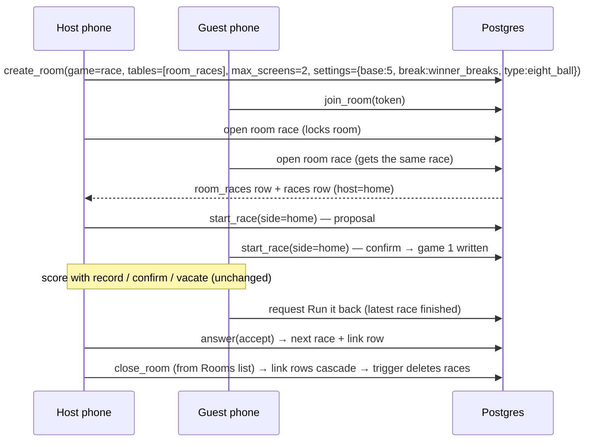

# feat: Room Race — score a two-player race inside a Game Room

## Overview

Make the already-built race engine (`feat/self-scoring-individual-races`) the
Game Room's second game. A host opens a Race room, invites one person, both
confirm who breaks, and they score a race to 5 from their own phones with
strict confirm. Alongside it come three room changes the brainstorm decided:
rooms stop deleting themselves, a host can delete any room from the list and
has a room cap, and the host gate moves to the **Host** designation.

## Problem Frame

Rooms exist so two people (friends now, a tournament pairing later) have a
place to play a match. The room and the race are both built, but on separate
unmerged branches, and nothing connects them. This plan wires them together
without giving the race any room-specific shape, so a tournament can reuse
the same race later (see origin: Key Decisions, "One race everywhere").

## Requirements Trace

| Origin req | Covered by |
|---|---|
| R1 (Race in game list, shared, 2 screens, the two people are the players) | Units 4, 6 |
| R2 (no setup screen) | Unit 6 |
| R3 (base 5, winner-breaks, game type as variables) | Unit 6 |
| R4–R5 (Who breaks? set + confirm; no referee) | Unit 3, Unit 6 |
| R6–R7 (strict confirm, reverse as built, informal rules) | unchanged engine; Unit 6 |
| R7a (winner only, no extras) | Unit 5 |
| R8 (simple scoreboard) | existing `RaceScoreboard`; Unit 6 |
| R9–R10 (last confirm ends it; results stay visible) | Units 4, 6 |
| R11 (Run it back: either asks, other accepts/denies) | Units 4, 6 |
| R11a (nobody locked in; pick up later) | Units 2, 4 |
| R11b (host deletes any room from the list) | Unit 7 |
| R11c (no self-delete; per-host room cap) | Unit 2 |
| R12 (nothing counts; Friends race deleted with its room) | Unit 4 |
| Host-designation dependency | Unit 1 (merge), Unit 2 |
| Gating dependency | Unit 6 (gate), Unit 8 (gate test + LIST_FOR_ED) |

## Scope Boundaries

- No free one-phone race (v2), no flip-for-the-break, no per-game "change breaker".
- No trust-but-verify / open modes, no finality or dispute rules.
- No scoreboard rebuild; `RaceScoreboard` is used as-is.
- No tournament, bracket or league wiring. The link table in Unit 4 is for room races only.
- No change to the coin flip's game logic. Its rooms *do* inherit the new host
  gate, persistence (no sweep) and the room cap, so the staging checklist
  re-checks a coin-flip room.

### Deferred to Separate Tasks

- Global modular scoreboard rebuild: its own project, which replaces `RaceScoreboard` afterwards.
- Free single-device race: v2, a separate piece.
- Un-gating rooms + race: when Ed signs off on staging (CLAUDE.md gating workflow).

## Context & Research

### Relevant Code and Patterns

- **Room plug-in contract:** `src/rooms/games/types.ts` (`GameDefinition`: `tables`, `screens`, `Setup?`, `Play`, `isReady`), `src/rooms/games/registry.ts`, `src/rooms/GameSlot.tsx`. The sibling to copy is `src/rooms/games/coinflip/` (definition, Play component, api file, refusal copy).
- **Room SQL:** `create_room` (latest in `supabase/migrations/20261010225123_room_occupancy.sql`) holds the host gate (`room_member_is_host`), `room_validate_tables` (every listed table needs a `room_id` FK to rooms with ON DELETE CASCADE, plus publication and REPLICA IDENTITY FULL), and the occupancy check. `close_room` (`20260916171612_game_rooms.sql`) already deletes a room for its host.
- **Sweep:** `supabase/migrations/20260916184405_game_rooms_sweep.sql`: `sweep_stale_rooms(24)` scheduled as pg_cron job `game-room-sweep` at 07:00 UTC. Tested by `src/__tests__/database/rooms.sweep.db.test.ts`.
- **Room realtime:** `src/rooms/useRoomRealtime.ts` listens to `game_tables` filtered by `room_id` and invalidates `['room', roomId, table]`. Its private `useHiddenRelease` drops the socket after `HIDDEN_RELEASE_MS` (2 min) hidden.
- **Race engine (race branch):** `supabase/migrations/20260910175307_races_sandbox.sql` (races, race_games and race_confirmations, all published, REPLICA IDENTITY FULL, children cascade from races) and `20260910181344_race_engine.sql` (`create_race` with defaults `alternate` / `eight_ball`, caller must be a player; `start_race` one-tap and idempotent; `record_race_game`, `confirm_race_game`, `vacate_race_game`).
- **Race UI (race branch):** `src/race/ScoreRace.tsx` takes `raceId` (+ optional `names`) and already handles a non-player viewer (`mySide === null`). `src/race/FirstBreakerPrompt.tsx`, `src/race/useRaceData.ts` (`useRaceRealtime`: its own channel `race:<id>`), `src/race/useRaceActions.ts`, `src/race/StartRacePage.tsx` (disposable per the race resume note).
- **Scoring dialog:** `src/components/scoring/ScoringDialog.tsx` already has a hide-a-control precedent (`hideForfeit`).
- **Host designation (main):** `supabase/migrations/20260919172451_add_designations_store.sql` (`member_has_designation(p_user_id, p_designation)`, which takes the **auth user id**, not the member id, and lets developer pass any check), `20260919182736_add_host_designation.sql`, and `useUserProfile.hasDesignation(name)`.

### Institutional Learnings

- Migrations need real UTC timestamps; check for duplicates before committing (CLAUDE.md).
- Deploys run `supabase db push --include-all`, so the race branch's September-dated migrations apply even though main has newer ones already applied. Verified in `.github/workflows/deploy-*.yml`.
- After a migration that touches the realtime publication, run `supabase stop && supabase start` locally (game-room memory).
- Tests that call supabase-js writes need the jsdom pragma; DB tests live under `src/__tests__/database/` (CLAUDE.md testing conventions).
- Auth uuid vs member id: the designation helper takes the user id, while room and race columns use the member id. Mixing them returns empty, not an error.
- Gate every door with the same condition as its route.

## Key Technical Decisions

- **One branch, three sources merged in.** `feat/room-race` (cut from `feat/game-room`) merges `feat/self-scoring-individual-races` and `main`. Trial merges show conflicts only in `TABLE_OF_CONTENTS.md`, `LIST_FOR_ED.md`, `src/navigation/NavRoutes.tsx` and `src/types/database.types.ts` (regenerate it, don't hand-merge). A stack of PRs was rejected because stacked PRs have stranded work off main before.
- **A room-owned link table, `room_races`**, one row per race played in the room (game 1, Run it back 1, …). It has a `room_id` cascade, is published and has full replica identity, so it **passes `room_validate_tables` unchanged**, and the race definition lists it as its one table. Race tables stay parent-free (origin decision).
- **Deleting a link row deletes its race, but only a race the room owns.** The link row carries `owns_race` (default true). An AFTER DELETE trigger (SECURITY DEFINER) deletes the race when `owns_race` is true. Closing the room cascades to the link rows, and the trigger removes the owned races and with them their games and confirmations. R12 holds by construction, with no cron. A later tournament door links its race with `owns_race = false`, so the result outlives the room without the room's delete semantics changing.
- **Server-side "open the race", idempotent under a lock, with a unique backstop.** One RPC, run by either player's phone, locks the room row. It returns the latest linked race if there is one (finished or not; only a Run it back accept makes the next race). Otherwise it creates the race plus link row 1. A unique index on `(room_id, sequence)` backs up the lock, the same way `race_games` backs its own.
- **The players are fixed at the first open:** the host (home) and the earliest other member on the guest list (away). Anyone who joins later can read the race but can't score it (`race_side_of` already refuses them). Run it back keeps the same two. Rejoining is the room's existing behavior: a known device walks straight back in. A player on a *new* device whose seat a third person took gets `room_full` until the host removes that person with ×. That's accepted for v1 and documented, not special-cased in the room.
- **Who breaks = propose / confirm in the engine itself** (origin: an intended engine change, since there's one race everywhere). `start_race` now records a proposal. The other player calling it with the same side starts the race. The proposer can re-call it with a different side to change the proposal before it's confirmed. The non-proposer gets Confirm only, with no "change", because the app doesn't referee (R4).
- **Run it back lives on the link row.** It records the requester. The other player accepts, which opens the next race with the same players and settings, or denies, which clears the request. Only a player in the latest race can request it, and only once that race is finished. **If both tap at once, the second request counts as an accept.**
- **Race live updates keep their own channel, but release and catch up with the room.** The race tables can't be room-filtered. Supabase multiplexes channels over one websocket, so this isn't an extra connection. It must still follow the hidden-tab release or a hidden phone keeps the socket alive, so `useHiddenRelease` moves to a shared hook and both the room and the race use it. Releasing without catching up would leave a returning phone stuck on "waiting", so `useRaceRealtime` also refetches the race, its games and its confirmations on every SUBSCRIBED, as `useRoomRealtime` does.
- **`room_races` permissions mirror the race tables, not the coin flip.** REVOKE ALL from anon and authenticated, then GRANT SELECT to authenticated (no RLS, matching `races` and the relaxed-RLS convention). Otherwise any client could delete a link row and, through the trigger, a race.
- **Winner-only scoring by a `hideExtras` prop on `ScoringDialog`**, mirroring `hideForfeit`. `ScoreRace` takes an `extras` option (default on, so the sandbox and future tournaments are unchanged), and the room race passes it off.
- **Settings have one source: the race definition.** `raceDefaults.ts` holds base 5, `winner_breaks` and `eight_ball`. A new optional `defaultSettings` on `GameDefinition` carries them into `create_room`'s existing `p_settings` (the client create path doesn't pass settings today). The open-race RPC reads them from the room and **refuses a missing key (`missing_setting`) rather than falling back**, so SQL never holds a second copy of the defaults. A room keeps the values it was created with. A future setup screen or tournament writes different values into the same slot.
- **The host gate moves to the designation.** `room_member_is_host(member_id)` is redefined to resolve the member's user id and call `member_has_designation(user_id, 'host')`. Every caller keeps working unchanged. The client's `CreateRoomDialog` switches from `useIsOperator` to `hasDesignation('host')`.
- **The sweep is retired and a room cap added.** Unschedule `game-room-sweep` and drop `sweep_stale_rooms` (dead once unscheduled). Add a `room_cap_per_host()` dial (10). `create_room` counts **every** room the caller owns, free and shared, for every creator, not just Hosts, since free rooms were the sweep's other job. The count runs under `pg_advisory_xact_lock` on the member (the `join_room` house-lock pattern), so two quick creates can't both pass. Refusal: `too_many_rooms`.

## Open Questions

### Resolved During Planning

- Can the race meet the room contract without room changes? Yes, through `room_races` (verified against `room_validate_tables`).
- Do the race's older-dated migrations deploy? Yes, `--include-all` is used in both deploy workflows.
- Is `close_room` reusable for delete-from-list? Yes, it's host-only and cascades.
- Who is home? The host. Game type: 8-ball (origin assumption, kept as a variable; Ed can change it).
- `/race/new` (`StartRacePage`): delete it, per the race resume note. Keep `/race/:raceId` gated as a dev entrance.

### Deferred to Implementation

- Exact RPC names and refusal-reason strings (follow the `room_*` / `race_*` naming and the existing refusal-copy files).
- Precise copy for "waiting for the other player to confirm who breaks" and the Run it back prompts.

## High-Level Technical Design

> *This illustrates the intended approach and is directional guidance for review, not implementation specification. The implementing agent should treat it as context, not code to reproduce.*

## Implementation Units

- [x] **Unit 1: Bring the three branches together** *(done 2026-11-03: `883c477e`, `7731d334`; 5995 tests green)*

**Goal:** `feat/room-race` contains the room, the race engine and current main, building and testing green before any new work.

**Requirements:** dependency for all of them.

**Dependencies:** none.

**Files:**
- Modify: `TABLE_OF_CONTENTS.md`, `LIST_FOR_ED.md`, `src/navigation/NavRoutes.tsx` (merge conflicts)
- Regenerate: `src/types/database.types.ts`

**Approach:**
- Merge the race branch, then main. Keep both sides of the route and doc conflicts. Regenerate the types from the local DB rather than hand-merging.
- Run the duplicate-migration-version check after the merge.

**Test scenarios:**
- Test expectation: none (no behavior change). The existing suites (room DB tests, race DB tests, unit tests) must all pass after the merge.

**Verification:**
- Build is clean, the room and race test suites are green, and there are no duplicate migration versions.

- [x] **Unit 2: Room changes: host designation, no sweep, room cap** *(done 2026-11-03: `53a39b32`)*

**Goal:** Host-designation members can open shared rooms, rooms no longer self-delete, and a host can hold at most `room_cap_per_host()` rooms.

**Requirements:** R11a, R11c, the host-designation dependency.

**Dependencies:** Unit 1.

**Files:**
- Create: `supabase/migrations/<utc>_room_host_designation_and_cap.sql`
- Modify: `src/rooms/CreateRoomDialog.tsx`, `src/rooms/roomRefusalCopy.ts`
- Delete: `src/__tests__/database/rooms.sweep.db.test.ts`
- Regenerate: `src/types/database.types.ts` (after applying the migration locally)
- Test: `src/__tests__/database/rooms.host.db.test.ts`, `src/__tests__/database/rooms.create.db.test.ts`

**Approach:**
- Redefine `room_member_is_host` to resolve the member's `user_id` and delegate to `member_has_designation(user_id, 'host')`.
- Unschedule `game-room-sweep` (guarded, so it's safe where pg_cron or the job is absent) and drop `sweep_stale_rooms`.
- Add the `room_cap_per_host()` dial and check it in `create_room` before insert. Refuse with `too_many_rooms`.
- The client gate reads `hasDesignation('host')`. The refusal copy says "You have N rooms. Delete one to start another."

**Patterns to follow:** `room_occupancy_cap()` dial + `bad_occupancy` refusal in `20261010225123_room_occupancy.sql`. Designation DB tests on main.

**Test scenarios:**
- Happy path: a member holding `host` creates a shared room → ok.
- Happy path: a developer (master key) creates a shared room → ok.
- Error path: a plain player (and a league operator without `host`) tries a shared room → `not_a_host`. A private room still works.
- Edge case: an ended `host` designation (`ended_at` set) → `not_a_host`.
- Edge case: a host at the cap → `too_many_rooms`. After `close_room` on one, creating succeeds.
- Edge case: a plain player creating *free* rooms also hits the cap (free rooms count).
- Integration: the `game-room-sweep` cron job no longer exists after the migration.

**Verification:**
- Room DB suites are green with the updated expectations, and the sweep test file is removed.

- [x] **Unit 3: Engine: who breaks becomes propose / confirm** *(done 2026-11-03: `95d016fa`)*

**Goal:** A race starts only after both players agree who breaks.

**Requirements:** R4, R5.

**Dependencies:** Unit 1.

**Files:**
- Create: `supabase/migrations/<utc>_race_first_breaker_confirm.sql`
- Modify: `src/race/FirstBreakerPrompt.tsx`, `src/race/ScoreRace.tsx`, `src/race/types.ts`, `src/race/useRaceActions.ts`
- Regenerate: `src/types/database.types.ts`
- Test: `src/__tests__/database/race.engine.db.test.ts`, `src/race/__tests__/FirstBreakerPrompt.test.tsx`

**Approach:**
- Add the proposed side and the proposer to `races`. `start_race` behavior: no proposal → record it; the proposer calls again → replace the proposal; the other player calls with the same side → start (existing game-1 write); the other player calls with a different side → refuse (`not_your_proposal`). That happens when both tap different names before realtime catches up, so the refusal gets copy ("X already picked — confirm, or sort it out at the table") and the race refetches.
- The proposal goes in new columns, and `first_breaker_side` stays NULL until confirm, so `race_breaker_side` and `race_advance` are unaffected.
- The prompt shows three states: nobody has picked (two name buttons), I proposed (the pick + "waiting for X", with the buttons still active so I can change it), they proposed (their pick + Confirm). Names only, never color alone.

**Execution note:** rewrite the existing start-of-race DB tests first (they currently assert one-tap start), then change the function.

**Test scenarios:**
- Happy path: home proposes `home` → status stays `created`, no game 1. Away confirms `home` → `in_play`, game 1 has home breaking.
- Happy path: the proposer changes `home` → `away` before confirm → the proposal is `away`. Confirming `away` starts it with away breaking.
- Error path: the non-proposer calls with the other side → refused, proposal unchanged (the simultaneous-opposite-taps case). The component shows the refusal copy and the refetched proposal.
- Error path: a non-player calls → `not_in_race`.
- Edge case: confirm after the race already started → `already_started` (idempotent, no second game 1).
- Edge case: the winner-breaks rule still decides game 2 after game 1 is confirmed (existing behavior intact).
- Component: each of the three prompt states renders the right buttons and labels for the viewer's side.

**Verification:**
- The race engine DB suite is green, with the start tests rewritten and every other race test unchanged.

- [ ] **Unit 4: `room_races`: open, Run it back, delete-with-room**

**Goal:** The room has a server-side link to its races. It opens the race once, handles Run it back, and deleting the room deletes its races.

**Requirements:** R1, R9–R12, R11a.

**Dependencies:** Units 2, 3.

**Files:**
- Create: `supabase/migrations/<utc>_room_races.sql`
- Regenerate: `src/types/database.types.ts`
- Test: `src/__tests__/database/roomRaces.db.test.ts`

**Approach:**
- The table has `room_id` (the first FK column, cascade), `race_id` (FK to races), a sequence number (unique with `room_id`), `owns_race` (default true), the rematch requester and a created time. It is published with full replica identity. Grants: REVOKE ALL, then GRANT SELECT to authenticated, with no RLS (Key Decisions). Writes go through RPCs only.
- The open-race RPC: the caller must have a phone in the room. Lock the room. If any link exists, return the latest one's race, finished or not. Otherwise pick the players: the host (home) and the earliest other member on the guest list (away). Refuse `need_opponent` when there's no other member and `missing_setting` when a setting key is absent. Insert the race (goals = the base from settings, break rule and game type from settings) and link row 1.
- Run it back: request (the caller is a player in the latest race and it's `finished`) sets the requester. A request from the other player while one is pending counts as an accept. Answer (the caller is the *other* player): accept opens the next race with the same two players and settings and clears the request; deny clears it.
- AFTER DELETE on `room_races` (SECURITY DEFINER, `search_path = public`) deletes the linked race when `owns_race` is true.

**Patterns to follow:** `supabase/migrations/20260916200041_room_coin_flips.sql` (a game table meeting the room contract plus its RPCs). `create_race` validation.

**Test scenarios:**
- Happy path: a room with host + guest → open returns a race with host home, goals 5/5, `winner_breaks`, `eight_ball`.
- Idempotency: two open calls in sequence (both phones) → one race, one link row. (The unique `(room_id, sequence)` index is the concurrency backstop. Inserting a duplicate sequence directly fails.)
- Edge case: the host alone, or the host on two devices with nobody else → `need_opponent`.
- Edge case: three members on the guest list → the race is the host vs the earliest other member, and the third can read but `record_race_game` refuses them.
- Edge case: open after the race finished → returns that finished race, with no new race.
- Error path: room settings missing `base` → `missing_setting`.
- Happy path: both players request Run it back → the second request accepts, one new race.
- Integration: a link row with `owns_race = false` deleted → the race survives.
- Error path: a signed-in client deleting a `room_races` row directly → permission denied.
- Edge case: settings with base 7 → goals 7/7 (proves the variable is read, not hard-coded).
- Happy path: after the race finishes, the guest requests Run it back and the host accepts → link row 2 with a fresh race in `created`. Race 1 stays readable.
- Error path: requesting Run it back while the race is unfinished → refused. The requester answering their own request → refused.
- Happy path: deny clears the request and no new race is made.
- Integration: `close_room` → no `room_races` rows, no races, race_games or race_confirmations left for that room.
- Integration: `room_validate_tables(['room_races'])` passes, so `create_room` accepts the race definition's table list.

**Verification:**
- The new DB suite is green, and the coin flip and room suites are unchanged.

- [ ] **Unit 5: Winner-only scoring option**

**Goal:** A room race records only who won each game.

**Requirements:** R7a.

**Dependencies:** Unit 1.

**Files:**
- Modify: `src/components/scoring/ScoringDialog.tsx`, `src/race/ScoreRace.tsx`
- Test: `src/components/scoring/ScoringDialog.test.tsx` (extend or create), `src/race/__tests__/ScoreRace.test.tsx`

**Approach:**
- Add a `hideExtras` prop that hides break & run, golden break, early 8, break-foul, runout, forfeit and the per-side value inputs, leaving the winner confirmation. `ScoreRace` gets an `extras` option (default true) and passes `hideExtras` when it's false. Every extra flag is sent as false.

**Patterns to follow:** `hideForfeit` in `ScoringDialog`.

**Test scenarios:**
- Happy path: `hideExtras` → none of the extra toggles render, and the winner name and submit button do.
- Regression: without `hideExtras` → every existing toggle still renders (league scoring unchanged).
- Integration: `ScoreRace` with `extras={false}` submitting a game sends all extra flags false.

**Verification:**
- Existing scoring dialog and league scoring tests stay green.

- [ ] **Unit 6: The Race room game**

**Goal:** Race appears as a room game and plays end to end in a room.

**Requirements:** R1–R3, R8–R11, success criteria 1–4.

**Dependencies:** Units 3, 4, 5.

**Files:**
- Create: `src/rooms/games/race/definition.ts`, `src/rooms/games/race/RoomRace.tsx`, `src/rooms/games/race/roomRaceApi.ts`, `src/rooms/games/race/useRoomRace.ts`, `src/rooms/games/race/RunItBack.tsx`, `src/rooms/games/race/raceDefaults.ts`, `src/rooms/games/race/roomRaceRefusalCopy.ts`
- Create: `src/realtime/useHiddenRelease.ts` (moved out of `useRoomRealtime`)
- Modify: `src/rooms/games/types.ts` (optional `defaultSettings`), `src/rooms/RoomsIndexPage.tsx` (pass `settings: game.defaultSettings` to create), `src/rooms/games/registry.ts` (race entry, **gated `!isProduction` here, where it's created**), `src/rooms/useRoomRealtime.ts`, `src/race/useRaceData.ts` (race channel released with the shared hook and refetched on every SUBSCRIBED)
- Test: `src/rooms/games/race/RoomRace.test.tsx`, `src/rooms/games/registry.test.ts`, `src/realtime/useHiddenRelease.test.ts`, `src/race/__tests__/useRaceRealtime.test.ts`, `src/rooms/RoomsIndexPage.test.tsx` (settings forwarded)

**Approach:**
- Definition: key `race`, tables `['room_races']`, screens 2/2, no Setup, `isReady` true, `defaultSettings` from `raceDefaults.ts` (base 5, `winner_breaks`, `eight_ball`). The create path forwards them to `create_room`'s `p_settings`. The `defaultSettings` field is a room-side generalization any game can use, not race-specific.
- `RoomRace`: no other member yet → the coin flip's "invite someone in" message. Otherwise call open (keyed `['room', roomId, 'room_races']`) and render `<ScoreRace raceId extras={false} names=… />` from the room's display names. A viewer who isn't one of the two players sees the race read-only (ScoreRace's existing `mySide === null`).
- Finished → `RunItBack` under the scoreboard: request button, "waiting for X" after asking, accept / deny for the other player. Earlier races in the room are listed compactly (final score only) so results stay visible.

**Patterns to follow:** `src/rooms/games/coinflip/` (definition, `useRoomCoinFlip`, api and refusal-copy split). Keep each file near ~100 lines.

**Test scenarios:**
- Happy path: two-member phones → `ScoreRace` renders for the race id from open.
- Edge case: one member only (one or two devices) → invite message, open not called.
- Edge case: a third member viewing → scoreboard shown, no score buttons.
- Realtime: the race channel's SUBSCRIBED (initial and after a hidden release) invalidates the race, games and confirmations queries.
- Gate: in production the registry doesn't list Race. In non-production it does.
- Happy path: finished race, I'm the requester → "waiting" state. I'm the other player → accept / deny shown.
- Happy path: after accept, the new race id renders and the previous result appears in the earlier-races list.
- Registry: the race entry declares 2 screens and `['room_races']`, and the coin flip entry is unchanged.
- Hidden release: the tab hidden past `HIDDEN_RELEASE_MS` → the hook reports released, and visible again → it resets. The room's existing realtime tests stay green after the move.

**Verification:**
- Locally, two accounts in two browsers: create a Race room, join, confirm who breaks, score to 5, Run it back, accept.

- [ ] **Unit 7: Delete a room from the Rooms list**

**Goal:** A host can delete any of their rooms without opening it.

**Requirements:** R11b.

**Dependencies:** Unit 1.

**Files:**
- Modify: `src/rooms/RoomsIndexPage.tsx`, `src/api/hooks/useRooms.ts` (if a list-level close hook is missing)
- Test: `src/rooms/RoomsIndexPage.test.tsx`

**Approach:**
- Rooms where `is_host` get a Delete button next to Open, behind a confirm dialog ("Delete this room? Anything in it is gone."). It calls the existing `close_room` and invalidates the list.

**Patterns to follow:** the End room confirm in `src/rooms/RoomActions.tsx`.

**Test scenarios:**
- Happy path: the host taps Delete, then confirms → `close_room` is called and the row leaves the list.
- Edge case: cancelling the confirm → no call.
- Edge case: a room where I'm only a guest → no Delete button.
- Error path: `close_room` refuses → toast with the refusal copy, and the row stays.

**Verification:**
- The rooms page tests are green.

- [ ] **Unit 8: Gates, dead code, docs**

**Goal:** Every new door is gated, the disposable entrance is gone, and the docs are current.

**Requirements:** gating dependency, doc rules.

**Dependencies:** Units 6, 7.

**Files:**
- Modify: `src/navigation/NavRoutes.tsx` (drop `/race/new`), `LIST_FOR_ED.md`, `TABLE_OF_CONTENTS.md`, `docs/plans/2026-09-10-self-scoring-resume-here.md` (point at this plan)
- Delete: `src/race/StartRacePage.tsx`
- Test: `src/navigation/roomsGate.test.tsx`

**Approach:**
- The gate test asserts the Race registry entry (gated in Unit 6) alongside the existing four rooms sites.
- `LIST_FOR_ED.md` gated section: "Room Race". It lists where every gate lives and what Ed checks on staging: two phones, who-breaks confirm, race to 5, Run it back, delete from the list, the Host-designation gate (grant yourself `host` first), **a coin-flip room still creates and shares as a Host**, and **confirm 8-ball as the default game type**.

**Test scenarios:**
- Gate: the gate test covers the five sites together (four rooms sites + the Race entry).

**Verification:**
- Build clean, all suites green.

> **TOC rule for every unit:** each unit that creates or deletes a file updates
> `TABLE_OF_CONTENTS.md` in that same commit (CLAUDE.md). Unit 8 only covers
> its own files.

## System-Wide Impact

- **Interaction graph:** `create_room`'s host gate changes for every game (the coin flip too). The sweep removal applies to all rooms.
- **State lifecycle risks:** races are deleted only through the `room_races` trigger. A race created outside a room (the `/race/:raceId` sandbox) is unaffected. Rooms now persist until deleted, which the per-host cap bounds.
- **API surface parity:** `start_race` semantics change for every caller (sandbox included), on purpose (origin decision). Jack's future mobile mirror must call it twice.
- **Integration coverage:** cascade-to-trigger deletion and the concurrent open are DB-level behaviors. They're covered in `roomRaces.db.test.ts`, not by mocks.
- **Unchanged invariants:** race tables get no `room_id`. `record_race_game`, `confirm_race_game` and `vacate_race_game` are unchanged. The league `ScoringDialog` behaves the same without `hideExtras`. The coin flip's tables and RPCs are untouched.

## Risks & Dependencies

| Risk | Mitigation |
|------|------------|
| A huge combined PR (room + race + this) | It's expected: neither base branch was ever PR'd. The PR description groups by source. Ed reviews on staging before un-gating. |
| A league operator who could host before loses it after the gate swap | Intended (the room doc always planned the swap). Grants are manual SQL today; note it in `LIST_FOR_ED.md` so Ed grants himself and testers `host`. |
| A hidden race tab keeps the socket alive | Shared `useHiddenRelease` used by both the room and race realtime hooks (Unit 6), with its own unit test. |
| Stale realtime container locally after the publication changes | `supabase stop && supabase start` noted in the verification step. |
| Migration version collision | Real UTC timestamps plus the duplicate check before each commit. |
| Reverting the race engine change drags the room along (one PR) | Accepted. The migrations are additive and gated in the UI, and a revert would be a forward-fix migration, not a PR revert. |
| `ScoringDialog` is already ~500 lines (well past the ~100-line target) | `hideExtras` is one condition. If it needs more than a few lines, split the extras block into its own component in that unit rather than growing the file. |

## Documentation / Operational Notes

- **Every schema and RPC change goes live in production on merge. Only the UI is gated.** That covers the room tables, the race tables, the propose/confirm `start_race`, the host-gate swap and the room cap. The sweep is created and removed in the same deploy, so production never runs it.
- Rooms and the Race game un-gate independently (separate gates), so Ed can turn on rooms with the coin flip before the race if he wants.
- The `/race/:raceId` sandbox now needs both players to start a race (propose + confirm). A solo developer test needs two accounts.
- `LIST_FOR_ED.md`: the gated entry plus "grant yourself the host designation to test".

## Sources & References

- **Origin document:** [docs/brainstorms/2026-11-03-room-race-requirements.md](../brainstorms/2026-11-03-room-race-requirements.md)
- Room requirements and plan: `docs/brainstorms/2026-09-16-game-room-requirements.md`, `docs/plans/2026-09-16-001-feat-game-room-plan.md`
- Race resume note: `docs/plans/2026-09-10-self-scoring-resume-here.md` (race branch)
