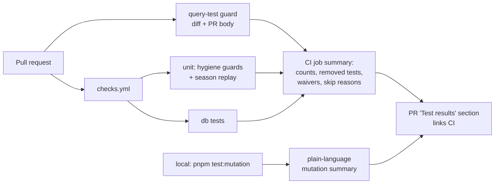

# feat: Trustworthy tests — machine guards, season replay, mutation testing

**Status:** active — no units started yet (plan written and reviewed 2026-11-17).

## Overview

Make the test suite prove itself instead of asking Ed to trust it. Built in
order of payoff, each phase shippable on its own:

1. **Phase 1 — the two highest-value checks:** a CI guard that fails a query
   change with no real-DB test (would have caught My Stats), and a replay of
   the one real completed season through the scoring code.
2. **Phase 2 — the rules and the readable results:** break-test rule + PR
   results template (no code), then skip/orphan/early-return guards and
   CI-sourced counts.
3. **Phase 3 — mutation testing** on the scoring math, run locally first.
4. **Phase 4 — the backlog:** triage of tests that fake the data layer, and a
   decision on each skipped group.

**Minimum useful set if time runs short:** U1 (query guard), U2–U4 (replay),
U5 (rules + template).

## Problem Frame

Nearly every test here was AI-written; Sikkema's article shows such tests
often pass while checking nothing. My Stats (#277) shipped a query Postgres
rejected outright while ~4,800 unit tests passed. Ed is new to testing,
won't watch runs, and wants readable results proving each test matters. The
same AI writes, proves and summarises the tests, so wherever a machine can
check, the machine checks — and every exception the AI grants itself is
shown by CI, not by the AI. (see origin: docs/brainstorms/2026-11-17-trustworthy-tests-requirements.md)

## Requirements Trace

| Origin req | What it needs | Unit(s) | Enforced by |
|---|---|---|---|
| R1 | CI flags query change without real-DB test | U1 | machine |
| R2 | New skip/todo/only fails CI without reason | U6 | machine |
| R3 | Test file matching no vitest project fails CI | U6 | machine |
| R4 | Every new/changed test proven able to fail, meaningful break | U5 | rule |
| R5 | Break record kept in the PR | U5 | rule + template |
| R6 | DB-side breaks inside a rolled-back transaction | U5 | rule |
| R7 | Real-DB query tests: exact values, an excluded row; fake exception | U1 (presence), U5 (adequacy) | machine + rule |
| R8 | Data-layer fakes triaged keep/convert/delete, risk-first | U9 | audit doc |
| R9 | Mutation testing on scoring/handicap TS | U8 | machine |
| R10 | Survivors covered or visibly accepted (with the code line) | U8 | machine report |
| R11 | Season replay answer key, anonymised | U2, U3, U4 | machine |
| R12 | Plain-language PR summary, CI-sourced counts | U5, U7 | template + machine |
| R13 | Readable mutation report | U8 | machine |
| R14 | Failures lead; counts match CI; dropped tests visible | U7 | machine |
| R15 | Every skipped group wired up or deleted; silent early-returns fail | U6, U10 | machine + fix |

## Scope Boundaries

- No AI test-reviewer checklist; no coverage-% target; no rewrite of all 392
  test files (see origin).
- Mutation testing covers TS scoring/handicap code only — not UI, not
  DB-stored module programs (parity tests cover those).
- The replay covers the one completed production season (Sunday 9-ball,
  standard handicap, 64 played matches — all with a saved system snapshot,
  none using a DB threshold chart). No playoffs or other systems exist in
  production yet.
- The repo is **public**: no names, real uuids or real dates in fixtures.

### Deferred to Separate Tasks

- **Converting** data-layer fakes — U9 produces the ordered list; each batch
  is its own small PR.
- **Mutation testing in CI** — after U8's first local run shows runtime and
  survivor count, decide whether a path-filtered Node 22 workflow is worth it
  and what score floor to set.
- Replay answer keys for other systems and playoffs, as real seasons complete.

## Context & Research

### Relevant Code and Patterns

- **Scoring is client-side TS; no DB trigger computes points.**
  `updateMatchRunningTotals` in `src/api/queries/matches.ts` runs the engine
  (`src/utils/match/engineRunningTotals.ts` →
  `src/systems/points-system/match-adapter.ts` →
  `src/systems/points-system/runtime.ts`) with the legacy
  `src/utils/match/computeMatchRunningTotals.ts` as fallback/auditor.
  **But the glue is not pure:** `computeEngineRunningTotals` is async and
  reads `match_lineups` through Supabase; the lineup → engine-input step
  (summing handicaps, adding the team modifier, position handicaps, game
  count) is unexported; snapshot parsing lives inside
  `updateMatchRunningTotals`. U2 extracts it.
- **Targets:** `calculateHandicapThresholds` and `computeMatchPrepPayload`
  are async (call `getTeamHandicapBonus(matchId)`); the pure core is the
  games-needed lookup (`src/utils/handicap/get3v3GamesNeeded.ts` /
  `get5v5GamesNeeded.ts`, `src/utils/handicap/*`) plus the frozen
  `match_lineups.home_team_modifier`.
- **Winner:** `src/utils/determineMatchResult.ts`, `src/systems/win-calculator/judge.ts`.
- **Replay data:** `matches` (stored targets, games won, points, winner,
  `system_snapshot`), `match_lineups` (only `locked = true`, matched by team:
  `player1..5_handicap` as of lock, `home_team_modifier`), `match_games`
  (winner side, home/away position, tiebreaker flag, confirmations,
  `winner_value` / `loser_value`).
- **Guard-test pattern:** `src/__tests__/unit/listForEd.test.ts` +
  `listForEd.helpers.ts`, `src/__tests__/unit/importPaths.test.ts` — pure
  helpers, planted-bad-input self-tests, then a real-tree block.
- **PR-diff CI check pattern:** `scripts/check-whats-new.mjs` +
  `.github/workflows/whats-new.yml` (diff `BASE_SHA..HEAD_SHA`, PR body via
  file, re-runs on `edited`), tests in `src/whatsNew/__tests__/checkWhatsNew.test.ts`.
- **Real-DB helpers:** `src/test/dbTestUtils.ts`; template for pointing the
  client at the real DB: `src/__tests__/database/17-point-smoke.test.ts`.
- **Prod read access:** `PROD_SERVICE_ROLE_KEY` in `.env.local`, URL in
  `scripts/clone-prod-to-local.mjs`.
- **Query code is everywhere:** `src/api/queries` (44), `mutations` (42),
  `hooks` (89) plus 85 files outside `src/api/` importing `@/supabaseClient`.
  Selects are often multi-line or held in constants (e.g. `GAME_SELECT` in
  `src/api/queries/playerGameHistory.ts`). `Array.from(` appears 64 times in
  non-test source.

### Institutional Learnings

- My Stats — green unit tests are not evidence a query works.
- The points engine was fixed mid-season (measured from the WIN target
  instead of par) with recalc scripts `database/maintenance/recalculate_points_3man_*`.
  If those weren't applied in production, early weeks will mismatch.
- Sub sentinels: anonymous subs share one uuid per side; some were promoted
  mid-season (`database/maintenance/promoteSubToRealPlayer.sql`).
- PostgREST caps unbounded selects at 1000 rows — page every fetch.
- happy-dom breaks supabase-js writes → `// @vitest-environment jsdom`.
- Read test output before pushing; `tail` once hid "1 failed".

### External References

- StrykerJS vitest runner: vitest 4 since 9.4.0 (≥9.6.1 for 4.1); 10.x needs
  Node ≥22 (local is 22.20); per-test coverage always on; no project
  selector → dedicated unit-only vitest config; `mutate` globs; incremental
  mode; `// Stryker disable next-line <mutator>: <reason>`; `json` reporter.
  https://stryker-mutator.io/docs/stryker-js/vitest-runner/ ·
  https://stryker-mutator.io/docs/stryker-js/configuration/

## Key Technical Decisions

- **Guards are repo-scanning unit tests where possible** (CI has no lint
  job; avoids `@vitest/eslint-plugin`'s TypeScript-6 peer). The query guard
  is a PR-diff script because it needs the diff and the PR body.
- **"Query code" = any changed hunk in a source file that contains a
  Supabase call anywhere** (client `.from('…')`, `.rpc(`, `.select(`, or a
  select-string constant) — not just lines carrying the token, so an edit to
  an embed on a continuation line counts. `Array.from` / `Buffer.from` are
  excluded by matching `.from('` / `.from("` / `` .from(` ``.
- **"Covered" = a db test calls one of the changed module's exports** (or
  references its exported select constant) — not a bare import. For
  components that query inline, the failure message says the fix: move the
  query into `src/api/` and test it there.
- **Opt-outs and skip reasons are surfaced by CI, never only by Claude:** the
  query guard's opt-out (`[no-db-test: <reason>]`) and every `skip-reason`
  are printed in the CI job summary under a fixed heading, so a waiver is
  visible even if Claude's PR text leaves it out. No approval step (Ed).
- **The replay is a regression check against league-accepted results, not
  independent truth.** Per-game winners were entered and confirmed by both
  teams (human input); targets and points were computed by our code at the
  time and accepted by the league over a season. A test pins a hash of the
  fixture's expected values, so editing an expected number or adding an
  exception shows up as its own visible change.
- **Replay runs in the `unit` project from a committed fixture** — scoring is
  pure TS once U2 extracts the glue; runs free on every PR.
- **Fixture is built from an explicit allow-list of fields**, everything else
  dropped. Uuids (including those inside the snapshot) map to stable fakes;
  sentinel sub ids keep their sentinel role; weeks are numbered, no dates;
  no confirmer identities or timestamps. A test fails if any uuid-shaped
  string other than the sentinels appears.
- **Mutation testing: local command first, CI later** (deferred) — decide on
  a workflow once runtime and survivor counts are known.
- **Accepted survivors use Stryker's disable comment with a reason**; the
  summary shows each one's code line, not just the reason.

## Open Questions

### Resolved During Planning

- All 64 played matches have `system_snapshot`; none use a DB threshold
  chart → replay needs no chart rows or live-prefs fallback (keep a guard
  that fails loudly if a later fixture has either).
- No test file is orphaned today; R3's guard is preventive (origin wording
  corrected).
- Mutate scope: `src/systems/**`, `src/utils/match/{computeMatchRunningTotals,engineRunningTotals,composeMatchThresholds,computeMatchPrepPayload}.ts`,
  `src/utils/handicap/*`, `src/utils/fargoMatchTotals.ts`,
  `src/utils/determineMatchResult.ts`, and the new pure builder from U2.
  `getTeamHandicapBonus.ts` is in only if its pure `computeTeamBonus` moves
  to its own file.

- **Waivers (Ed, 2026-11-17):** printed by CI only — no Ed approval step.
- **Paper spot-check (Ed, 2026-11-17):** none exist; scoring is paperless.
  The season is finished, players are satisfied, and its records are
  effectively final — the replay's league-accepted values are the answer key.
- **Playoff bonus (Ed, 2026-11-17):** already fixed on main (#312 — team
  bonus is 0 in a playoff week, DB-tested). What isn't pinned is the other
  half: player handicaps must still count in playoffs. Added to U2.

### Deferred to Implementation

- Whether the mid-season recalc was applied in production — the first replay
  run answers it.
- Mutation runtime on Ed's machine (72 non-test files in `src/systems/` alone).
- Whether CI's seed suffices to wire up each skipped group (U10).

## High-Level Technical Design

> *Directional guidance for review, not implementation specification.*

## Implementation Units

### Phase 1 — The two highest-value checks

- [ ] **U1: Query-change guard**

**Goal:** A PR that changes Supabase query code without a real-DB test that
exercises it fails CI; any waiver is printed by CI.

**Requirements:** R1, R7 (presence)

**Dependencies:** None

**Files:**
- Create: `scripts/check-query-tests.mjs`
- Create: `.github/workflows/query-tests.yml`
- Test: `src/__tests__/unit/checkQueryTests.test.ts`

**Approach:**
- Inputs: changed files with their changed hunks, and the PR body — both
  written to files as in `whats-new.yml`.
- Query code and coverage as in Key Technical Decisions. Test files,
  `*.d.ts` and deleted files are ignored.
- Waiver `[no-db-test: <reason>]`, reason non-empty; written to the job
  summary under "Waivers". Runs on `pull_request` incl. `edited`.
- Before making it a hard failure, run it over the last ~30 merged PRs'
  diffs to measure how often it would have fired; tune if it's noisy.

**Patterns to follow:** `scripts/check-whats-new.mjs`, `.github/workflows/whats-new.yml`,
`src/whatsNew/__tests__/checkWhatsNew.test.ts`.

**Test scenarios:**
- Error path: **the real #277 diff** (embed changed inside the select string, no db test) → fail naming `playerGameHistory.ts`.
- Error path: only a continuation line of a multi-line `.select(` changed → fail.
- Happy path: query module changed and a db test calls its export → pass.
- Error path: a db test only imports the module, never calls it → fail.
- Error path: `src/operator/components/X.tsx` adds `.from('matches')` → fail, message suggests moving the query to `src/api/`.
- Happy path: waiver with reason → pass, reason shown in summary.
- Error path: `[no-db-test: ]` → fail.
- Edge case: a change adding only `Array.from(` → not query code.
- Edge case: a file with no Supabase call at all → ignored.

**Verification:** The real #277 diff fails; the 30-PR dry run shows a firing
rate Ed can live with.

- [ ] **U2: Extract the pure scoring glue (refactor)**

**Goal:** The steps between stored rows and the scoring engine become pure,
exported functions that production and the replay both call — so the replay
tests the real glue, not a copy.

**Requirements:** R11 (enables)

**Dependencies:** None

**Files:**
- Create: `src/utils/match/buildEngineArgs.ts` (lineups + match row + snapshot → engine inputs)
- Modify: `src/utils/match/engineRunningTotals.ts`, `src/api/queries/matches.ts` (call the builder)
- Modify (if needed): the pure targets path so it takes the frozen modifier instead of looking it up
- Test: `src/utils/match/buildEngineArgs.test.ts`

**Approach:** Move, don't rewrite — production behaviour must be identical.
Async/DB reads stay in the callers; the builder takes plain data.

**Execution note:** Characterization first — pin current outputs for a few
matches before moving code.

**Patterns to follow:** existing pure helpers in `src/utils/match/`.

**Test scenarios:**
- Happy path: 3v3 lineups with handicaps + modifier → expected summed inputs and position handicaps.
- Edge case: unlocked lineup present → ignored; only locked ones used.
- Edge case: snapshot with `per_game_allocator` null → treated as production does.
- Error path: missing snapshot → explicit error, not a silent fallback.
- Happy path (playoffs): playoff match with a 0 team modifier and real player handicaps → player handicaps still summed into the inputs; only the team bonus is absent.
- Integration: existing `match-adapter` and `engineRunningTotals` tests stay green unchanged.

**Verification:** No behaviour change (existing suites green); the builder
has no Supabase import.

- [ ] **U3: Read-only season fetch + anonymised fixture**

**Goal:** One command reads the completed season from production (SELECT
only) and writes an allow-listed, anonymised fixture.

**Requirements:** R11

**Dependencies:** U2 (the fixture holds exactly what the builder needs)

**Files:**
- Create: `scripts/fetch-season-fixture.mjs`
- Create: `scripts/fetchSeasonFixture.helpers.mjs` (pure anonymiser + field allow-list)
- Create: `src/__tests__/fixtures/season-2026-sunday-9ball.json` (generated, committed)
- Test: `src/__tests__/unit/fetchSeasonFixture.test.ts`

**Approach:**
- Reads the key from `.env.local`; never writes to production; pages every
  select.
- Per played match: stored targets, games won, points, winner,
  `system_snapshot`, both **locked** lineups' handicaps + modifier, every
  game (winner side, positions, tiebreaker flag, values, confirmed yes/no).
- Allow-list only; uuids → stable fakes (incl. inside the snapshot);
  sentinels kept; week numbers instead of dates.

**Test scenarios:**
- Happy path: same player in two matches → same fake id.
- Edge case: sentinel sub uuid → kept as sentinel.
- Edge case: snapshot `per_game_allocator_id` uuid → replaced.
- Error path: an unexpected extra field in the source row → dropped, not copied.
- Edge case: BYE matches excluded.

**Verification:** 64 matches in the fixture; the U4 privacy test passes.

- [ ] **U4: Season replay test**

**Goal:** Every fixture match, re-run through today's scoring code,
reproduces its recorded result.

**Requirements:** R11

**Dependencies:** U2, U3

**Files:**
- Create: `src/__tests__/unit/seasonReplay.test.ts`
- Create: `src/__tests__/unit/seasonReplay.helpers.ts`

**Approach:**
- Per match, via U2's builder: recompute targets and compare to stored;
  run engine and legacy paths on the recorded games; compare games won,
  points, winner; engine and legacy must agree.
- One test per match, named by week and fake teams, so a failure reads
  "Week 9, Team C vs Team F: points expected −4/+4, got −3/+3".
- Privacy test: no uuid-shaped string other than sentinels; no field
  outside the allow-list.
- Integrity test: hash of all expected values + exceptions is pinned; any
  change to them fails until the hash is updated in the same diff.
- Mismatches on first run go to Ed: real bug (own PR) or a named exception
  with its reason. No tolerances.

**Execution note:** First run is characterization — it tells us whether the
mid-season points recalc was applied in production.

**Test scenarios:**
- Happy path: all 64 matches reproduce games won, points, targets, winner.
- Edge case: a 9-9 tie split by handicap (Week of Heads vs Team Duff, −4/+4) reproduces.
- Edge case: a match with a sentinel sub reproduces.
- Integration: engine and legacy agree on every match.
- Error path: break the points math (measure from win target instead of par) → many matches red — the break record for this unit.
- Error path: edit one expected value in the fixture → hash test fails.

**Verification:** All green or Ed-approved named exceptions; the deliberate
break turns it red.

### Phase 2 — Rules and readable results

- [ ] **U5: Break-test rule + PR results template**

**Goal:** The break-test and real-DB rules live where every session reads
them, and every PR's results section has a fixed shape.

**Requirements:** R4, R5, R6, R7 (adequacy), R12

**Dependencies:** None

**Files:**
- Create: `.github/pull_request_template.md` ("Test results" section)
- Modify: `CLAUDE.md` (Testing Conventions)
- Modify: `src/__tests__/README.md`

**Approach:** Template: failures first → link to the Checks run (counts come
from CI, U7) → one line per new/changed test ("protects: …; checks: <exact
value>") → collapsed "Break records" (the break made + the red result).
Rules: break in the way the test exists to catch; DB-side breaks inside
`BEGIN … ROLLBACK`; real-DB query tests insert known rows, assert exact
values and one excluded row; renames/import moves exempt.

**Test expectation:** none — documentation and template.

**Verification:** The next test-touching PR uses the template.

- [ ] **U6: Hygiene guards — skips, orphans, silent early returns**

**Goal:** CI fails on an unexplained skip/todo, any `.only`, any test file no
project runs, and a db test that returns before asserting.

**Requirements:** R2, R3, R15 (prevention)

**Dependencies:** None (U10 resolves the existing 4 skips; until then they
carry reasons)

**Files:**
- Create: `src/__tests__/unit/testHygiene.helpers.ts`
- Create: `src/__tests__/unit/testHygiene.test.ts`
- Modify: `vitest.config.ts` (db project includes `.tsx`, so converted
  component tests can run there — U9 needs it)
- Modify: the 4 skipped files (`// skip-reason:` until U10)

**Approach:**
- Skip guard: `.skip(`, `.todo(`, `skipIf`, `ctx.skip(`, `x`-prefixed,
  conditional `(cond ? it : it.skip)` each need `// skip-reason:` above;
  `.only` never allowed. Every reason is also printed in the job summary.
- Orphan guard: import the vitest config's project include/exclude rather
  than duplicating globs; every `src/**/*.{test,spec}.{ts,tsx}` matches
  exactly one project.
- Early-return guard (db tests): a bare `return` before any `expect` in a
  test body is flagged.

**Patterns to follow:** `src/__tests__/unit/listForEd.test.ts`.

**Test scenarios:**
- Error path: planted `it.skip(` without reason → file:line reported.
- Error path: planted `it.only(` even with reason → reported.
- Error path: planted `(flag ? it : it.skip)` without reason → reported.
- Edge case: the word "skip" inside a string/comment → not flagged.
- Error path: planted test file matching no project → orphan reported.
- Error path: planted db test with `if (!rows.length) return;` before expect → reported.
- Edge case: `tests/e2e/**` (Playwright) out of scope.

**Verification:** An unexplained skip on a scratch branch turns the unit job
red with a message saying what to add.

- [ ] **U7: CI-sourced counts and removed-test report**

**Goal:** Every PR's Checks run shows passed/failed/skipped counts and names
any test that exists on main but not on the branch.

**Requirements:** R12, R14

**Dependencies:** U6 (prints skip reasons alongside)

**Files:**
- Create: `scripts/test-summary.mjs`
- Modify: `.github/workflows/checks.yml` (unit + db jobs: default + JSON
  reporters; summary step runs `if: always()`)
- Test: `src/__tests__/unit/testSummary.test.ts`

**Approach:** Pure over the report file(s); failures first; skipped/todo
counted and named; removed tests = names on main's report minus this run's
(main's report taken from the latest main run's artifact).

**Test scenarios:**
- Happy path: 10 passed → "10 passed, 0 failed, 0 skipped".
- Error path: 2 failed → failures listed first.
- Edge case: skipped and todo → counted and named separately.
- Error path: missing/empty report → non-zero exit, clear message.
- Edge case: test present on main, absent here → listed under "Removed tests".

**Verification:** A PR with one deliberately failing test shows it first in
the job summary even though the test step failed.

### Phase 3 — Mutation testing

- [ ] **U8: Stryker (local) + plain-language report**

**Goal:** `pnpm test:mutation` mutates the scoring/handicap code, runs only
unit tests, and writes a summary Ed can read.

**Requirements:** R9, R10, R13

**Dependencies:** U4 (the replay is the strongest mutant-killer)

**Files:**
- Create: `stryker.config.mjs`
- Create: `vitest.stryker.config.ts` (unit-only, happy-dom, db excluded)
- Create: `scripts/mutation-summary.mjs`
- Modify: `package.json` (pinned matching Stryker core + runner; script)
- Modify: `.gitignore` (`reports/`, `.stryker-tmp/`)
- Test: `src/__tests__/unit/mutationSummary.test.ts`

**Approach:** concurrency 2, `ignoreStatic`, incremental; mutate scope as
resolved. Summary: "Of N deliberate mistakes, tests caught X. Missed:
file:line + the change in plain words. Accepted: count, each with its code
line and reason. Tests that covered mutants but caught none: …". First full
report goes to Ed; survivors get tests or a reasoned disable comment.

**Test scenarios:**
- Happy path: all killed → "caught all N".
- Happy path: 2 survived → each with file:line and change in words.
- Edge case: accepted (disabled) mutants → separate count, each showing the code line + reason.
- Edge case: test covering mutants but killing none → listed.
- Error path: missing report → non-zero exit.

**Verification:** A full local run completes on Ed's machine; the summary
reads without knowing Stryker.

### Phase 4 — The backlog

- [ ] **U9: Data-layer fake triage list**

**Goal:** Every test that fakes the Supabase client or the query/hook layer
listed once with keep / convert / delete and a reason, ranked by risk.

**Requirements:** R8

**Dependencies:** U1, U6 (`.tsx` in the db project)

**Files:**
- Create: `docs/audits/2026-11-17-data-layer-fakes-triage.md`

**Approach:** ~61 files (17 client fakes minus `17-point-smoke.test.ts`,
which is already real, plus 45 query/hook fakes). Convert-candidates ranked
user-facing + recently changed.

**Test expectation:** none — audit doc.

**Verification:** Every faking file appears exactly once with a decision.

- [ ] **U10: Skipped groups — wire up or delete; fix existing early returns**

**Goal:** The 4 skipped DB groups are wired up or deleted, and existing db
tests that pass on empty data are made to fail instead.

**Requirements:** R15

**Dependencies:** U6

**Files:**
- Modify: `src/__tests__/database/houseRules.rls.test.ts`,
  `per-game-allocator-schema.test.ts`, `ratingMutationAtomicity.db.test.ts`,
  `thresholdChartsRls.db.test.ts`
- Modify: db tests U6's early-return guard reports (e.g. `playerGameHistory.db.test.ts`)

**Approach:** Wire up where CI's seed suffices; otherwise delete and note
what coverage is lost. Replace "no rows → return" with a fixture insert or an
explicit failure. Removes U6's stopgap skip reasons.

**Test scenarios:**
- Happy path: each wired-up group passes against CI seed.
- Error path: with its fixture rows removed, a former early-return test fails.

**Verification:** No stopgap `skip-reason` lines remain; U6's early-return
guard has no exceptions.

## System-Wide Impact

- **CI:** one new workflow (query-tests) and a changed `checks.yml`; merge
  one at a time and watch the next Checks run.
- **Production code:** only U2 (a behaviour-preserving extraction).
- **Every future PR:** may hit the query guard; waivers are cheap but always
  printed by CI.
- **CLAUDE.md:** gains the break-test, real-DB and results rules.

## Risks & Dependencies

| Risk | Mitigation |
|---|---|
| Replay mismatches from un-applied recalcs / data fixes | Named exceptions with reasons, Ed-approved, hash-pinned |
| Replay enshrines a wrong value the league accepted | Labelled a regression check; season is final and league-accepted (Ed) |
| Query guard noisy → gets disabled | 30-PR dry run before enforcing; precise matching; waiver path |
| Claude waives its way to green | CI prints every waiver and skip reason (Ed: printing is enough) |
| Fixture leaks private data in a public repo | Field allow-list, uuid scan test, no dates |
| U2 refactor changes scoring | Characterization first; existing suites must stay green |
| Mutation run too slow on Ed's machine | concurrency 2, incremental, narrow scope; CI deferred |

## Sources & References

- **Origin document:** [docs/brainstorms/2026-11-17-trustworthy-tests-requirements.md](../brainstorms/2026-11-17-trustworthy-tests-requirements.md)
- Article: https://albertsikkema.com/ai/development/testing/2026/06/08/your-ai-tests-are-probably-lying-to-you.html
- Points fix history: `memory-bank/plans/PLAN-standings-points-fix.md`
- StrykerJS vitest runner: https://stryker-mutator.io/docs/stryker-js/vitest-runner/
